# Earlier diagnostic view — superseded

**Read the [current scientific analysis](paper-focused/READ_RESULTS.md) or [executed notebook](paper-focused/results.ipynb) instead.** It selects the paper-relevant comparison and explains the trade-off. The blanket unlinked-score warnings below no longer apply to its selected, checked inputs. This earlier view is preserved for history, not the recommended paper narrative.

> **Scores not yet linked to selected sequences. Provide the sequence file used for each score export, its run settings and structural mapping before using these as final paper results.**

1,000 sequence records · 4,000 imported measurements · 40 source-specific groups · 22 plots. Measurements include the repeated workbook view, not extra independent observations.

Read each source, cohort, case, domain and endpoint separately. BioPhi source-selected score, Overview Identity and promb peptide content are not interchangeable. The 9NH7 ensemble workbook repeats a CSV population. No pairing, causal effect, clinical immunogenicity or binding claim is established. Framework and CDR RMSD are different endpoints; geometry is unvalidated.

**Reader:** use the case links below. **Updater:** open [the executed notebook](Update_results.ipynb) and edit the marked setup section. No JSON editing required.

## Are the files and sequences right?
400 same-ID sequence disagreements; 6 source/domain groups with possible ID offsets. Ask which sequence set was actually scored; do not shift IDs or attach scores by row number.

- Latest Jacob Drive / rerun delivery: NOT RECOVERED; included Jacob files are the Oct25 repository snapshot, not a later handoff.
- A run-bound measured-sequence manifest for each OASis and structural export, including source input hashes and settings.
- Corrected baseline identity agreed by the team; current repository and Jacob designs disagree.
- PDB atom/residue mapping and run provenance for structural acceptance; CSVs alone do not validate geometry.
- Team-approved endpoint, cohort and statistical comparison policy; no pairing or hypothesis tests are selected here.
- Original paper-era loop-group ablation inputs remain unverified here; current ablation files are NOT selected in this configuration.
- AbLang trained-head provenance and AbMPNN generation provenance are not established by these saved outputs.

- [9NFU details](#9nfu)

- [9NH7 details](#9nh7)

## 9NFU

### Humanness: where do the saved scores fall?

#### not-specified-in-export — BioPhi source-selected OASis score
**Cohort:** repository-final-filled  
**Source:** `inputs/sanithu/Oasis_compute/output/oasis_abmpnn_summary.csv`

Horizontal: saved fraction (0–1). Rightward means larger scores, not lower clinical immunogenicity. Vertical: fraction of nonmissing values at or below x. Read the median at height 0.5; legends give present and missing counts.

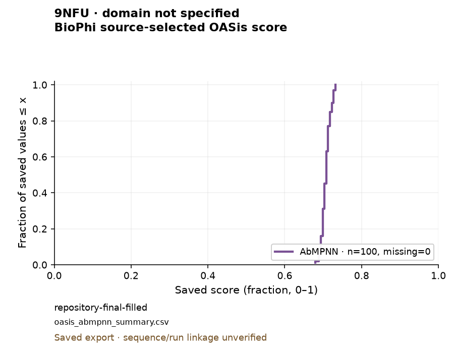

**Readout:** AbMPNN: median 0.7081, 100 present, 0 missing.

**Limit:** Unpaired saved draws, not independent biological replicates. Sequence/run linkage unverified. Shared endpoint scales can make narrow distributions look vertical; tails are not clipped.

#### not-specified-in-export — BioPhi Overview OASis Identity
**Cohort:** repository-final-filled  
**Source:** `inputs/sanithu/Oasis_compute/output/oasis_ensemble_summary.csv`

Horizontal: saved fraction (0–1). Rightward means larger scores, not lower clinical immunogenicity. Vertical: fraction of nonmissing values at or below x. Read the median at height 0.5; legends give present and missing counts.

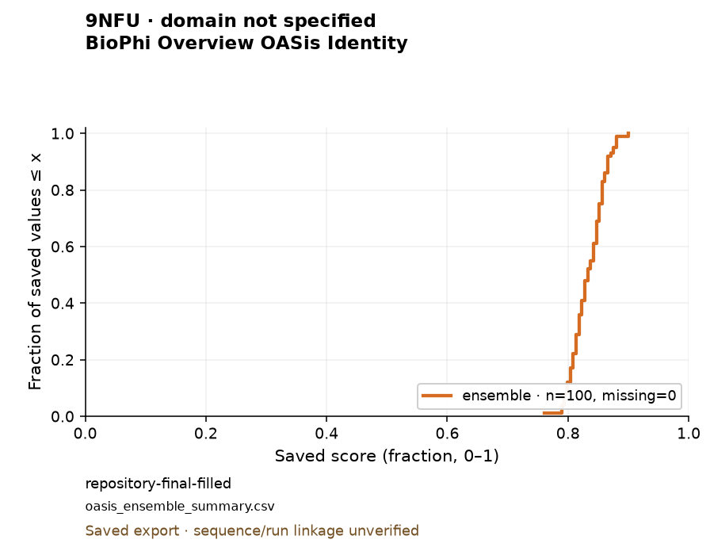

**Readout:** ensemble: median 0.8325, 100 present, 0 missing.

**Limit:** Unpaired saved draws, not independent biological replicates. Sequence/run linkage unverified. Shared endpoint scales can make narrow distributions look vertical; tails are not clipped.

#### not-specified-in-export — BioPhi source-selected OASis score
**Cohort:** repository-final-filled  
**Source:** `inputs/sanithu/Oasis_compute/output/oasis_proteinmpnn_summary.csv`

Horizontal: saved fraction (0–1). Rightward means larger scores, not lower clinical immunogenicity. Vertical: fraction of nonmissing values at or below x. Read the median at height 0.5; legends give present and missing counts.

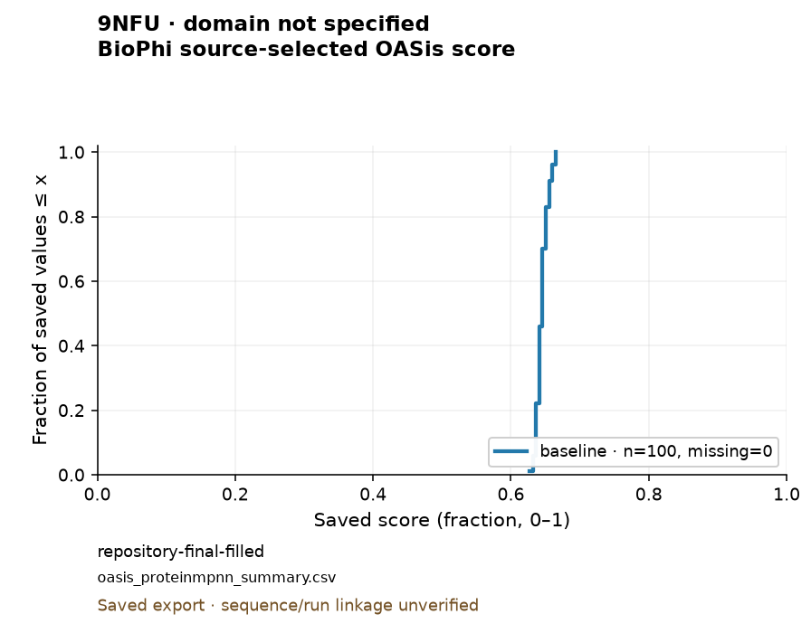

**Readout:** baseline: median 0.6459, 100 present, 0 missing.

**Limit:** Unpaired saved draws, not independent biological replicates. Sequence/run linkage unverified. Shared endpoint scales can make narrow distributions look vertical; tails are not clipped.

#### VH — promb human-oas peptide content (not BioPhi)
**Cohort:** Jacob-repository-Oct25  
**Source:** `inputs/sanithu/wilcoxon_task_files/3_data/oasis_scores_promb.csv`

Horizontal: saved fraction (0–1). Rightward means larger scores, not lower clinical immunogenicity. Vertical: fraction of nonmissing values at or below x. Read the median at height 0.5; legends give present and missing counts.

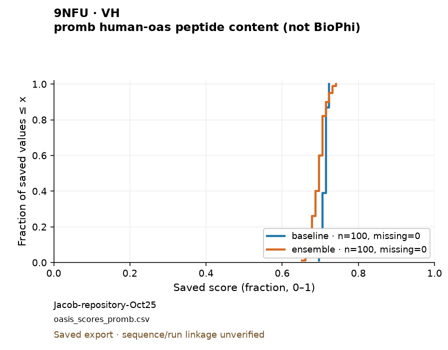

**Readout:** baseline: median 0.7143, 100 present, 0 missing; ensemble: median 0.6964, 100 present, 0 missing.

**Limit:** Unpaired saved draws, not independent biological replicates. Sequence/run linkage unverified. Shared endpoint scales can make narrow distributions look vertical; tails are not clipped.

#### VL — promb human-oas peptide content (not BioPhi)
**Cohort:** Jacob-repository-Oct25  
**Source:** `inputs/sanithu/wilcoxon_task_files/3_data/oasis_scores_promb.csv`

Horizontal: saved fraction (0–1). Rightward means larger scores, not lower clinical immunogenicity. Vertical: fraction of nonmissing values at or below x. Read the median at height 0.5; legends give present and missing counts.

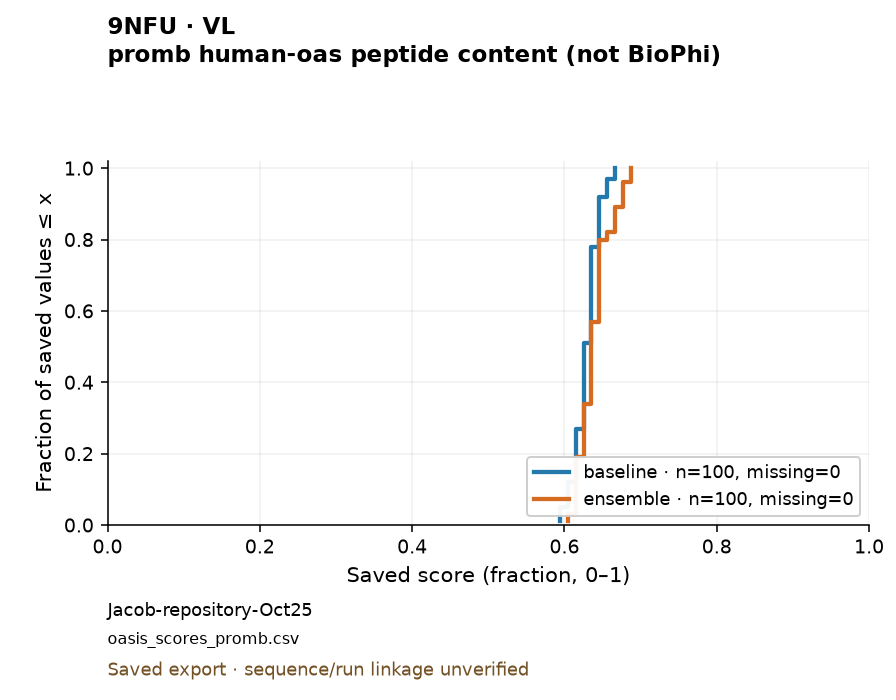

**Readout:** baseline: median 0.6250, 100 present, 0 missing; ensemble: median 0.6354, 100 present, 0 missing.

**Limit:** Unpaired saved draws, not independent biological replicates. Sequence/run linkage unverified. Shared endpoint scales can make narrow distributions look vertical; tails are not clipped.

### Structure: how large are the reported deviations?

#### VH — Framework RMSD export
**Cohort:** repository-final-filled  
**Source:** `inputs/sanithu/RSMD_RESULTS/cdr_rmsd_framework.csv`

Horizontal: reported RMSD (Å). Leftward means smaller deviations under this export’s alignment, not better binding. Vertical: fraction of nonmissing values at or below x. Read the median at height 0.5; legends give present and missing counts.

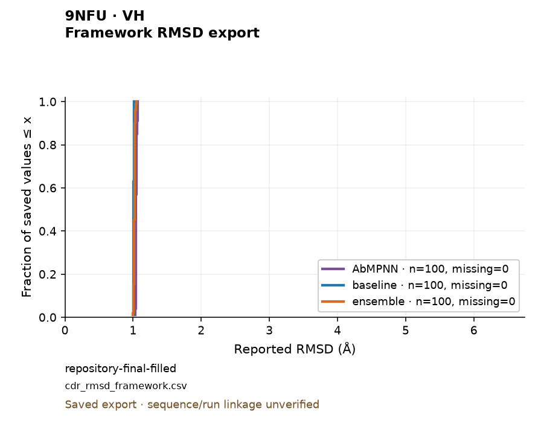

**Readout:** AbMPNN: median 1.0435, 100 present, 0 missing; baseline: median 1.0085, 100 present, 0 missing; ensemble: median 1.0200, 100 present, 0 missing.

**Limit:** Unpaired saved draws, not independent biological replicates. Sequence/run linkage unverified. Shared endpoint scales can make narrow distributions look vertical; tails are not clipped.

#### VL — Framework RMSD export
**Cohort:** repository-final-filled  
**Source:** `inputs/sanithu/RSMD_RESULTS/cdr_rmsd_framework.csv`

Horizontal: reported RMSD (Å). Leftward means smaller deviations under this export’s alignment, not better binding. Vertical: fraction of nonmissing values at or below x. Read the median at height 0.5; legends give present and missing counts.

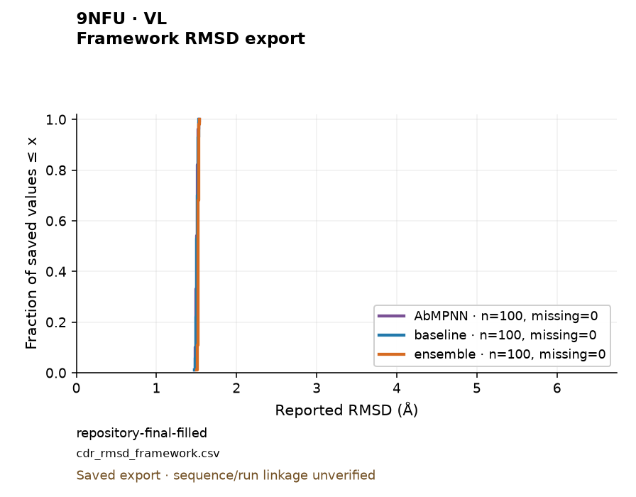

**Readout:** AbMPNN: median 1.5050, 100 present, 0 missing; baseline: median 1.5045, 100 present, 0 missing; ensemble: median 1.5210, 100 present, 0 missing.

**Limit:** Unpaired saved draws, not independent biological replicates. Sequence/run linkage unverified. Shared endpoint scales can make narrow distributions look vertical; tails are not clipped.

#### H1 — CDR RMSD v3 export
**Cohort:** Jacob-repository-Oct25  
**Source:** `inputs/sanithu/wilcoxon_task_files/3_data/cdr_rmsd_results_v3.csv`

Horizontal: reported RMSD (Å). Leftward means smaller deviations under this export’s alignment, not better binding. Vertical: fraction of nonmissing values at or below x. Read the median at height 0.5; legends give present and missing counts.

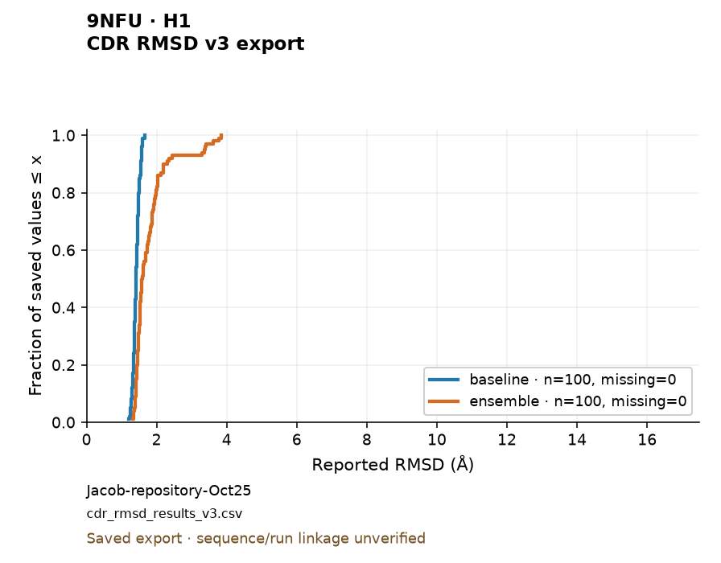

**Readout:** baseline: median 1.4185, 100 present, 0 missing; ensemble: median 1.5895, 100 present, 0 missing.

**Limit:** Unpaired saved draws, not independent biological replicates. Sequence/run linkage unverified. Shared endpoint scales can make narrow distributions look vertical; tails are not clipped.

#### H2 — CDR RMSD v3 export
**Cohort:** Jacob-repository-Oct25  
**Source:** `inputs/sanithu/wilcoxon_task_files/3_data/cdr_rmsd_results_v3.csv`

Horizontal: reported RMSD (Å). Leftward means smaller deviations under this export’s alignment, not better binding. Vertical: fraction of nonmissing values at or below x. Read the median at height 0.5; legends give present and missing counts.

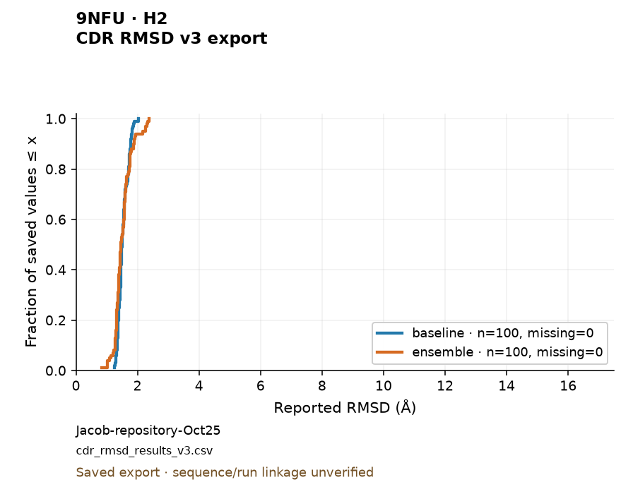

**Readout:** baseline: median 1.5015, 100 present, 0 missing; ensemble: median 1.4645, 100 present, 0 missing.

**Limit:** Unpaired saved draws, not independent biological replicates. Sequence/run linkage unverified. Shared endpoint scales can make narrow distributions look vertical; tails are not clipped.

#### H3 — CDR RMSD v3 export
**Cohort:** Jacob-repository-Oct25  
**Source:** `inputs/sanithu/wilcoxon_task_files/3_data/cdr_rmsd_results_v3.csv`

Horizontal: reported RMSD (Å). Leftward means smaller deviations under this export’s alignment, not better binding. Vertical: fraction of nonmissing values at or below x. Read the median at height 0.5; legends give present and missing counts.

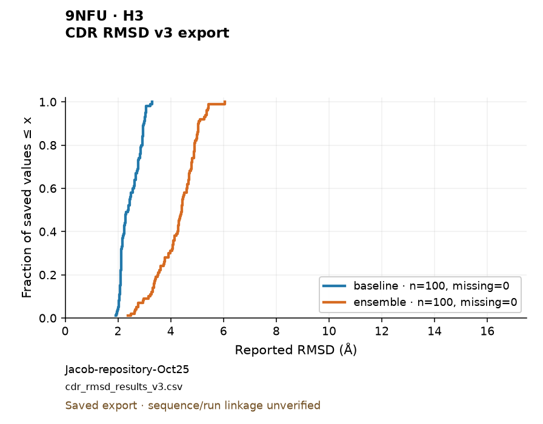

**Readout:** baseline: median 2.3775, 100 present, 0 missing; ensemble: median 4.4190, 100 present, 0 missing.

**Limit:** Unpaired saved draws, not independent biological replicates. Sequence/run linkage unverified. Shared endpoint scales can make narrow distributions look vertical; tails are not clipped.

#### L1 — CDR RMSD v3 export
**Cohort:** Jacob-repository-Oct25  
**Source:** `inputs/sanithu/wilcoxon_task_files/3_data/cdr_rmsd_results_v3.csv`

Horizontal: reported RMSD (Å). Leftward means smaller deviations under this export’s alignment, not better binding. Vertical: fraction of nonmissing values at or below x. Read the median at height 0.5; legends give present and missing counts.

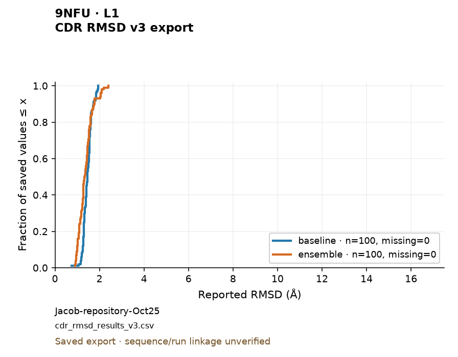

**Readout:** baseline: median 1.4635, 100 present, 0 missing; ensemble: median 1.3365, 100 present, 0 missing.

**Limit:** Unpaired saved draws, not independent biological replicates. Sequence/run linkage unverified. Shared endpoint scales can make narrow distributions look vertical; tails are not clipped.

#### L2 — CDR RMSD v3 export
**Cohort:** Jacob-repository-Oct25  
**Source:** `inputs/sanithu/wilcoxon_task_files/3_data/cdr_rmsd_results_v3.csv`

Horizontal: reported RMSD (Å). Leftward means smaller deviations under this export’s alignment, not better binding. Vertical: fraction of nonmissing values at or below x. Read the median at height 0.5; legends give present and missing counts.

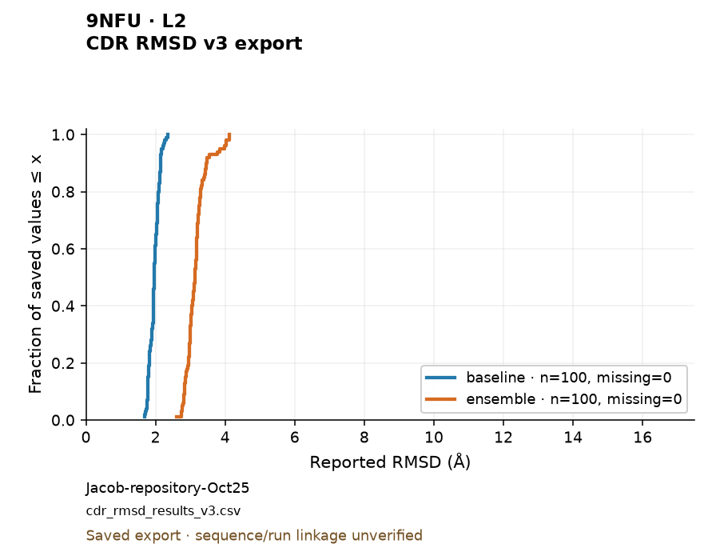

**Readout:** baseline: median 1.9570, 100 present, 0 missing; ensemble: median 3.1355, 100 present, 0 missing.

**Limit:** Unpaired saved draws, not independent biological replicates. Sequence/run linkage unverified. Shared endpoint scales can make narrow distributions look vertical; tails are not clipped.

#### L3 — CDR RMSD v3 export
**Cohort:** Jacob-repository-Oct25  
**Source:** `inputs/sanithu/wilcoxon_task_files/3_data/cdr_rmsd_results_v3.csv`

Horizontal: reported RMSD (Å). Leftward means smaller deviations under this export’s alignment, not better binding. Vertical: fraction of nonmissing values at or below x. Read the median at height 0.5; legends give present and missing counts.

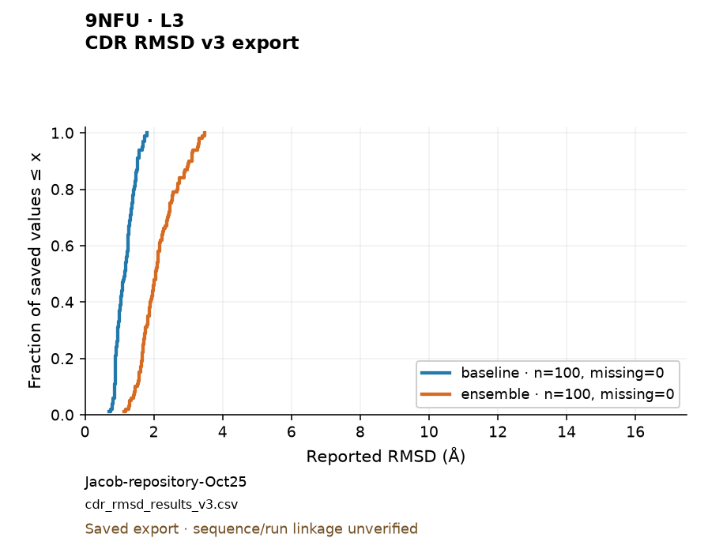

**Readout:** baseline: median 1.1560, 100 present, 0 missing; ensemble: median 2.0595, 100 present, 0 missing.

**Limit:** Unpaired saved draws, not independent biological replicates. Sequence/run linkage unverified. Shared endpoint scales can make narrow distributions look vertical; tails are not clipped.

## 9NH7

### Humanness: where do the saved scores fall?

#### not-specified-in-export — BioPhi source-selected OASis score
**Cohort:** repository-final-filled  
**Source:** `inputs/sanithu/Oasis_compute/output/oasis_abmpnn_summary.csv`

Horizontal: saved fraction (0–1). Rightward means larger scores, not lower clinical immunogenicity. Vertical: fraction of nonmissing values at or below x. Read the median at height 0.5; legends give present and missing counts.

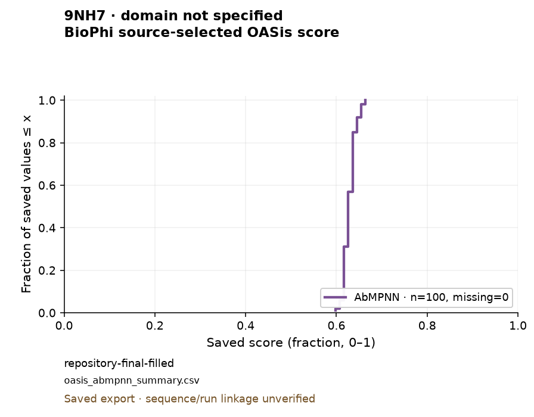

**Readout:** AbMPNN: median 0.6262, 100 present, 0 missing.

**Limit:** Unpaired saved draws, not independent biological replicates. Sequence/run linkage unverified. Shared endpoint scales can make narrow distributions look vertical; tails are not clipped.

#### not-specified-in-export — BioPhi Overview OASis Identity
**Cohort:** repository-final-filled  
**Source:** `inputs/sanithu/Oasis_compute/output/oasis_ensemble_summary.csv`

Horizontal: saved fraction (0–1). Rightward means larger scores, not lower clinical immunogenicity. Vertical: fraction of nonmissing values at or below x. Read the median at height 0.5; legends give present and missing counts.

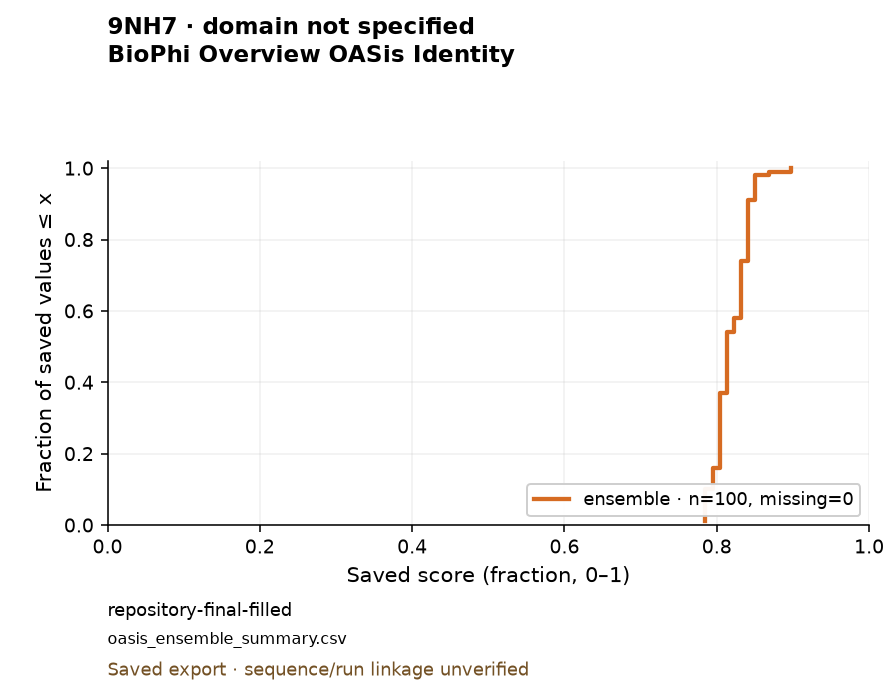

**Readout:** ensemble: median 0.8131, 100 present, 0 missing.

**Limit:** Unpaired saved draws, not independent biological replicates. Sequence/run linkage unverified. Shared endpoint scales can make narrow distributions look vertical; tails are not clipped.

#### not-specified-in-export — BioPhi Overview OASis Identity
**Cohort:** repository-final-filled  
**Source:** `inputs/sanithu/Oasis_compute/output/oasis_output_ensemble/9NH7_ensemble_oasis.xlsx`

Horizontal: saved fraction (0–1). Rightward means larger scores, not lower clinical immunogenicity. Vertical: fraction of nonmissing values at or below x. Read the median at height 0.5; legends give present and missing counts.

**Readout:** ensemble: median 0.8131, 100 present, 0 missing.

**Limit:** Unpaired saved draws, not independent biological replicates. Sequence/run linkage unverified. Shared endpoint scales can make narrow distributions look vertical; tails are not clipped.

#### not-specified-in-export — BioPhi source-selected OASis score
**Cohort:** repository-final-filled  
**Source:** `inputs/sanithu/Oasis_compute/output/oasis_proteinmpnn_summary.csv`

Horizontal: saved fraction (0–1). Rightward means larger scores, not lower clinical immunogenicity. Vertical: fraction of nonmissing values at or below x. Read the median at height 0.5; legends give present and missing counts.

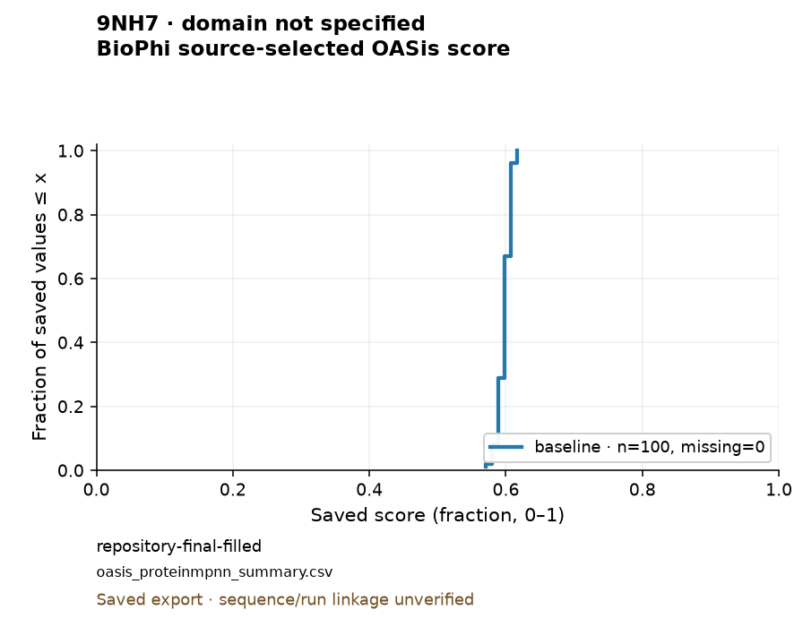

**Readout:** baseline: median 0.5981, 100 present, 0 missing.

**Limit:** Unpaired saved draws, not independent biological replicates. Sequence/run linkage unverified. Shared endpoint scales can make narrow distributions look vertical; tails are not clipped.

#### VHH — promb human-oas peptide content (not BioPhi)
**Cohort:** Jacob-repository-Oct25  
**Source:** `inputs/sanithu/wilcoxon_task_files/3_data/oasis_scores_promb.csv`

Horizontal: saved fraction (0–1). Rightward means larger scores, not lower clinical immunogenicity. Vertical: fraction of nonmissing values at or below x. Read the median at height 0.5; legends give present and missing counts.

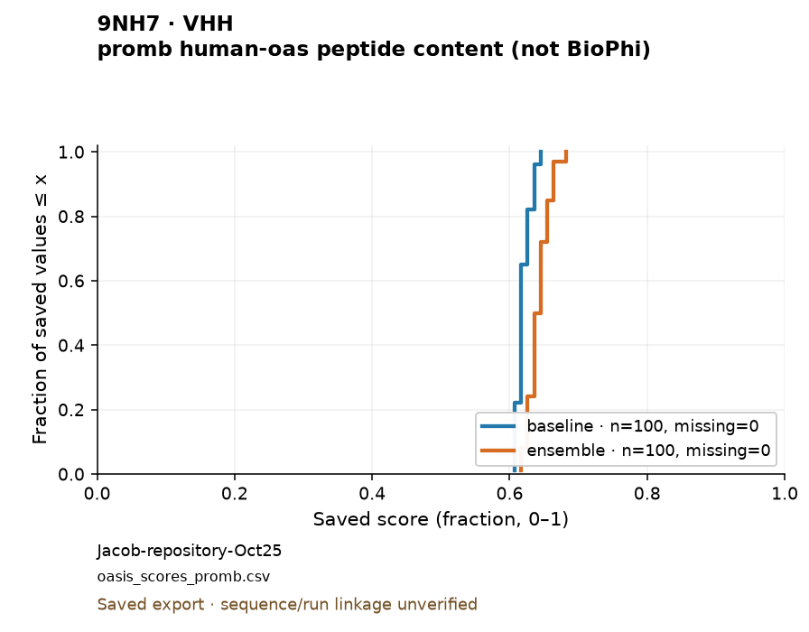

**Readout:** baseline: median 0.6168, 100 present, 0 missing; ensemble: median 0.6402, 100 present, 0 missing.

**Limit:** Unpaired saved draws, not independent biological replicates. Sequence/run linkage unverified. Shared endpoint scales can make narrow distributions look vertical; tails are not clipped.

### Structure: how large are the reported deviations?

#### VHH — Framework RMSD export
**Cohort:** repository-final-filled  
**Source:** `inputs/sanithu/RSMD_RESULTS/cdr_rmsd_framework.csv`

Horizontal: reported RMSD (Å). Leftward means smaller deviations under this export’s alignment, not better binding. Vertical: fraction of nonmissing values at or below x. Read the median at height 0.5; legends give present and missing counts.

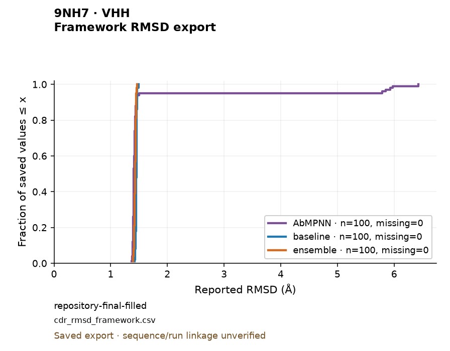

**Readout:** AbMPNN: median 1.4080, 100 present, 0 missing; baseline: median 1.4530, 100 present, 0 missing; ensemble: median 1.4330, 100 present, 0 missing.

**Limit:** Unpaired saved draws, not independent biological replicates. Sequence/run linkage unverified. Shared endpoint scales can make narrow distributions look vertical; tails are not clipped.

#### H1 — CDR RMSD v3 export
**Cohort:** Jacob-repository-Oct25  
**Source:** `inputs/sanithu/wilcoxon_task_files/3_data/cdr_rmsd_results_v3.csv`

Horizontal: reported RMSD (Å). Leftward means smaller deviations under this export’s alignment, not better binding. Vertical: fraction of nonmissing values at or below x. Read the median at height 0.5; legends give present and missing counts.

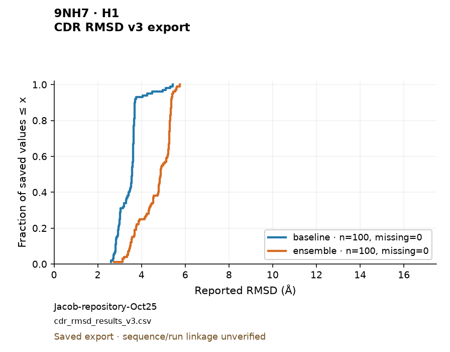

**Readout:** baseline: median 3.5750, 100 present, 0 missing; ensemble: median 4.8770, 100 present, 0 missing.

**Limit:** Unpaired saved draws, not independent biological replicates. Sequence/run linkage unverified. Shared endpoint scales can make narrow distributions look vertical; tails are not clipped.

#### H2 — CDR RMSD v3 export
**Cohort:** Jacob-repository-Oct25  
**Source:** `inputs/sanithu/wilcoxon_task_files/3_data/cdr_rmsd_results_v3.csv`

Horizontal: reported RMSD (Å). Leftward means smaller deviations under this export’s alignment, not better binding. Vertical: fraction of nonmissing values at or below x. Read the median at height 0.5; legends give present and missing counts.

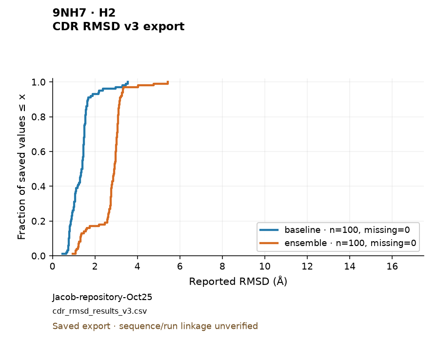

**Readout:** baseline: median 1.3840, 100 present, 0 missing; ensemble: median 2.9180, 100 present, 0 missing.

**Limit:** Unpaired saved draws, not independent biological replicates. Sequence/run linkage unverified. Shared endpoint scales can make narrow distributions look vertical; tails are not clipped.

#### H3 — CDR RMSD v3 export
**Cohort:** Jacob-repository-Oct25  
**Source:** `inputs/sanithu/wilcoxon_task_files/3_data/cdr_rmsd_results_v3.csv`

Horizontal: reported RMSD (Å). Leftward means smaller deviations under this export’s alignment, not better binding. Vertical: fraction of nonmissing values at or below x. Read the median at height 0.5; legends give present and missing counts.

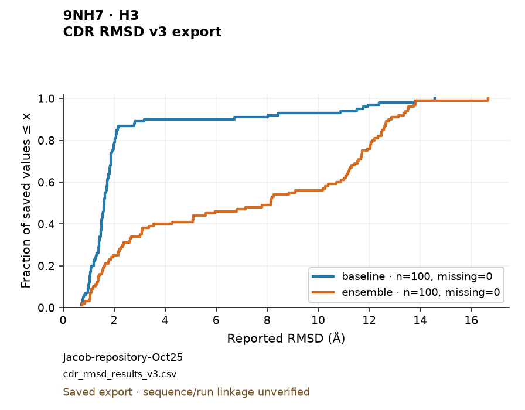

**Readout:** baseline: median 1.6100, 100 present, 0 missing; ensemble: median 8.1420, 100 present, 0 missing.

**Limit:** Unpaired saved draws, not independent biological replicates. Sequence/run linkage unverified. Shared endpoint scales can make narrow distributions look vertical; tails are not clipped.

## What should we fix or export?
Obtain the actual scored/folded sequence set and run manifest; resolve conflicting IDs without guessing; agree the cohort, endpoint and statistical design. Re-run this notebook to review a new dated bundle. No model inference or publication occurs here.

[Executed notebook](Update_results.ipynb) · [Update guide](README.md) · Download mobile.html for an offline phone-friendly view. GitHub shows HTML source, not a hosted page.
