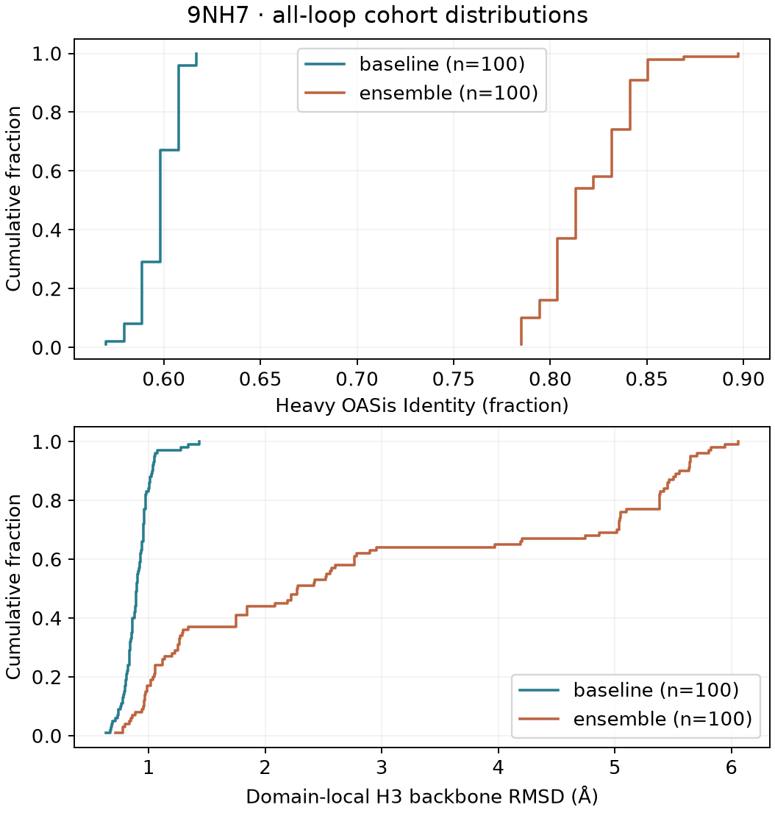
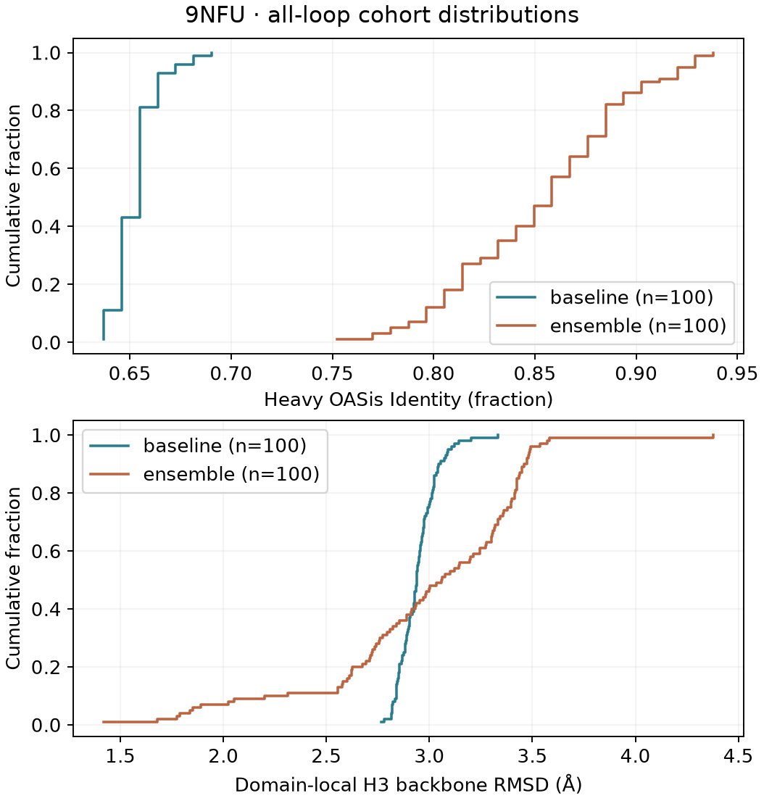

# Supporting analyses

Return to [Table 1 and Figure 1](READ_RESULTS.md). These plots show every retained main design; low-confidence designs are not removed. Read ECDFs as the fraction of designs at or below each x-axis value, not uncertainty intervals.

## Complete selected loop table

| structure | cdr | baseline_n | baseline_median_A | baseline_below70 | ensemble_n | ensemble_median_A | ensemble_below70 |
| --- | --- | --- | --- | --- | --- | --- | --- |
| 9NH7 | H1 | 100 | 2.5735 | 0 | 100 | 2.6475 | 0 |
| 9NH7 | H2 | 100 | 0.801 | 0 | 100 | 1.184 | 0 |
| 9NH7 | H3 | 100 | 0.896 | 0 | 100 | 2.275 | 32 |
| 9NFU | H1 | 100 | 1.266 | 0 | 100 | 1.0835 | 0 |
| 9NFU | H2 | 100 | 1.407 | 0 | 100 | 2.0865 | 0 |
| 9NFU | H3 | 100 | 2.939 | 0 | 100 | 3.0595 | 18 |
| 9NFU | L1 | 100 | 1.2865 | 0 | 100 | 1.307 | 0 |
| 9NFU | L2 | 100 | 1.882 | 0 | 100 | 2.3335 | 11 |
| 9NFU | L3 | 100 | 1.032 | 0 | 100 | 1.6395 | 6 |

All selected baseline/ensemble loops, marginal medians in Å, with draw counts and mean loop pLDDT below-70 counts. No confidence filtering is applied. N/CA/C RMSD follows motif-defined spans after separate domain framework fits to deposited reference chains E (9NH7) and C (9NFU); CDR atoms are excluded from fitting. This does not measure relative VH/VL orientation or whole-scFv preservation.

[Machine-readable loop table](tables/loops.csv)

## Light-domain ablation control

| structure | condition | n_pairs | mean_difference | positive | zero |
| --- | --- | --- | --- | --- | --- |
| 9NFU | cdrh3 | 100 | 0.0 | 0 | 100 |
| 9NFU | others | 100 | 0.1403125 | 100 | 0 |

9NFU light-domain Identity: cdrh3: mean paired gain +0.0000000, 0/100 positive, 100/100 unchanged; others: mean paired gain +0.1403125, 100/100 positive, 0/100 unchanged. Heavy and light denominators are separate; no cross-chain efficiency inference follows.

## 9NH7

## 9NFU

## Alternative endpoints are not interchangeable

Jacob’s `promb` human-oas peptide-content scores are not BioPhi Heavy OASis Identity. His v3 whole-framework CA fit uses different loop spans and predicted structures; in scFv it also includes inter-domain orientation. It is not an alignment-only sensitivity of Table 1. No alternate-cohort numbers are blended here.

The [chain-specific ablation table](tables/ablation.csv) keeps light-domain denominators separate. Gain per designed residue is only a heuristic: overlapping peptide windows are not additive residue effects. No structural-preservation claim follows from this ablation.
