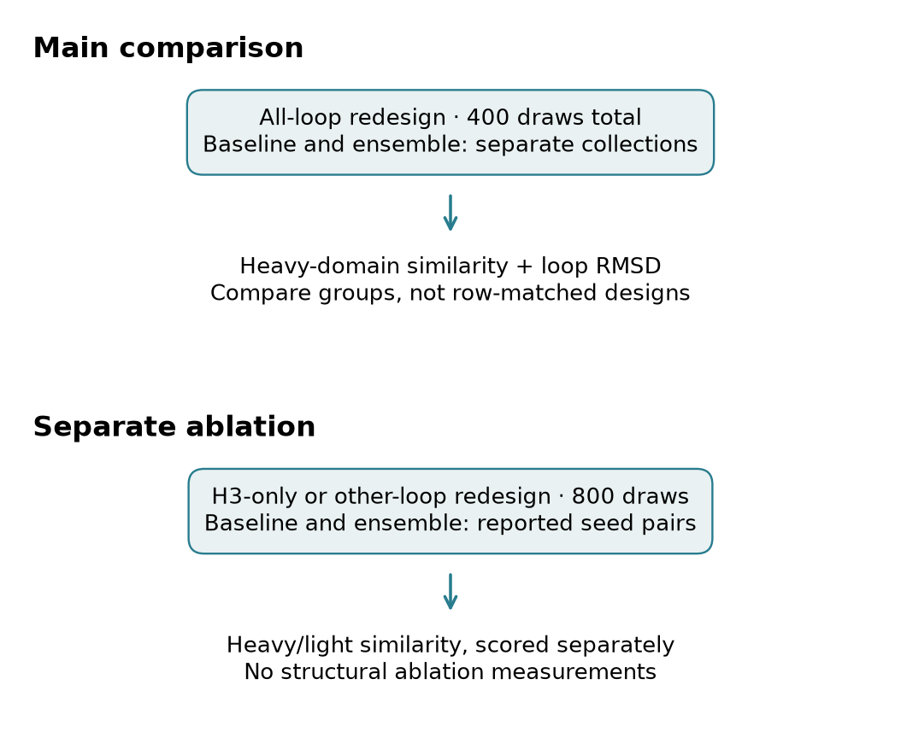
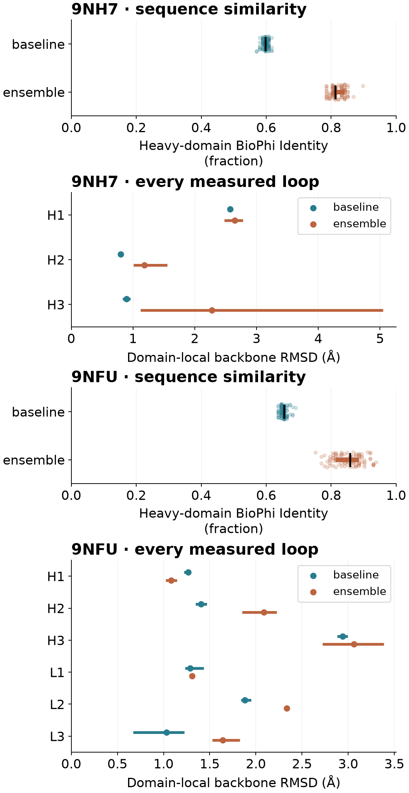
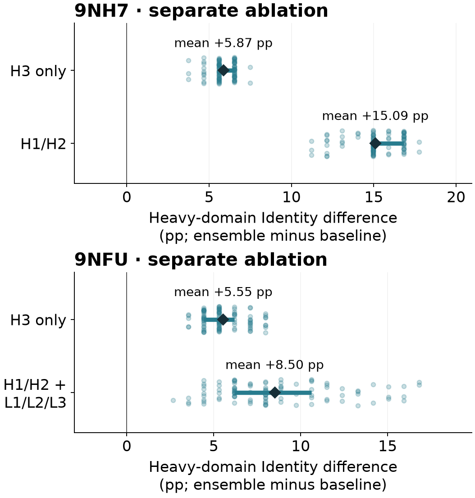

# Repertoire similarity and structural cost

## Are the sequences more human-like, and what happens to their predicted structures?

Ensemble sequences score higher on human-antibody sequence similarity in both examples (whole heavy-domain medians). 9NH7: higher heavy-domain repertoire similarity and higher H3 backbone RMSD in the ensemble median. 9NFU: higher heavy-domain repertoire similarity and higher H3 backbone RMSD in the ensemble median. The retained median pattern does not support a blanket no-structural-cost claim; the structural shift must be read case by case, alongside spread and confidence. The H3 median increase is larger for 9NH7 (+1.3790 Å) than 9NFU (+0.1205 Å); this is an observed scale difference, not a biological-significance threshold.

Pinned retained-input analysis

Two questions, two separate collections. Main comparison: all-loop redesign, sequence similarity and predicted structure. Ablation: H3-only versus other-loop redesign, sequence similarity only. Arrows show which measurements belong to each collection, not a causal effect.

## Figure 1 · Sequence similarity and every measured loop

Light sequence dots are all 100 observed draws per arm in each case; black ticks mark medians. Structural dots are group medians for every measured loop. Thick lines show the middle half (25th–75th percentiles), not confidence intervals. All draws keep their original weight, including repeated sequences. Baseline and ensemble are separate collections: no row-pairing or connecting designs. Higher Identity means more human-repertoire sequence similarity; lower RMSD means closer to the deposited reference. These are whole heavy-domain scores and domain-local loop distances, not immune-response or binding measurements.

Across 9NFU loops, median RMSD increases larger than its H3 shift occur in H2, L2, L3; decreases (improvements relative to the reference) occur in H1. The H3 result is not overall scFv preservation. The complete supporting loop table retains all draws. Low confidence means mean loop pLDDT below 70, not any low-confidence residue, and does not explain away every worsening: 9NFU H2 below-70 counts are 0 baseline and 0 ensemble.

## Table 1 · Numerical reference

| Case | Heavy-domain Identity, B → E | Δ Identity | H3 RMSD, B → E (Å) | Δ RMSD (Å) |
| --- | --- | --- | --- | --- |
| 9NH7 | 0.5981 → 0.8131 | +0.2150 | 0.8960 → 2.2750 | +1.3790 |
| 9NFU | 0.6549 → 0.8584 | +0.2035 | 2.9390 → 3.0595 | +0.1205 |

Each main cell is a median over 100 draws per arm per case; B = baseline, E = ensemble. Deltas are differences of marginal medians, not paired changes. Higher Identity indicates greater repertoire similarity; higher RMSD indicates greater displacement from the deposited reference.

## Figure 2 · Where are differences seen in the separate ablation?

100 reported pairs per condition; 800 ablation designs in total. Figure 2 uses a separate loop-group generation cohort. Light dots show individual reported seed-pair differences; dark diamonds show the mean and thick lines the middle half (IQR), not confidence intervals. Positive differences favor ensemble sequence similarity. The source defines a same-decoder, same-seed zero-AbLang-logit control, but the executed helper revision/import resolution and weights are not authenticated. Thus these are descriptive retained outputs, not proof that AbLang alone caused the changes. Other CDRs means H1/H2 for 9NH7 and H1/H2 + L1/L2/L3 for 9NFU. The 9NFU heavy score is from joint heavy/light redesign, not an isolated heavy-loop intervention. No matched ablation structural results are supplied.

9NH7: the mean difference outside H3 is higher than H3-only (+0.15093 versus +0.05869); positive reported pairs: 100/100 versus 100/100. 9NFU: the mean difference outside H3 is higher than H3-only (+0.08504 versus +0.05549); positive reported pairs: 100/100 versus 100/100.

9NFU light-domain Identity: cdrh3: mean paired gain +0.0000000, 0/100 positive, 100/100 unchanged; others: mean paired gain +0.1403125, 100/100 positive, 0/100 unchanged. Heavy and light denominators are separate; no cross-chain efficiency inference follows.

## What this evidence supports

Neither overlapping ranges nor a small mean shift establishes structural non-inferiority: a meaningful margin and justified uncertainty analysis are needed. Predicted RMSD does not measure binding. These are draw-weighted designs on two fixed cases, not independent biological experiments or evidence of an antibody-format effect. No p-values, confidence intervals, or causal acceptance are inferred here.

For the pinned original inputs, prior audit linked scored VH to final-filled FASTAs and full predicted sequences, and replayed the implemented coordinate measurements without numeric discrepancies. This package rechecks the scored-VH/FASTA link and recalculates retained metrics; it does not rerun coordinate replay, folding or BioPhi scoring. Computation verification is distinct from independent biological mapping or causal acceptance.

[Spread and confidence details](APPENDIX.md) · [Sources and methods](SOURCES.md) · [Update guide](README.md) · [Executed notebook](results.ipynb) · [Author checklist — Paper changes](AUTHOR_CHECKLIST.md) · [Engineering checks](engineering/README.md)
